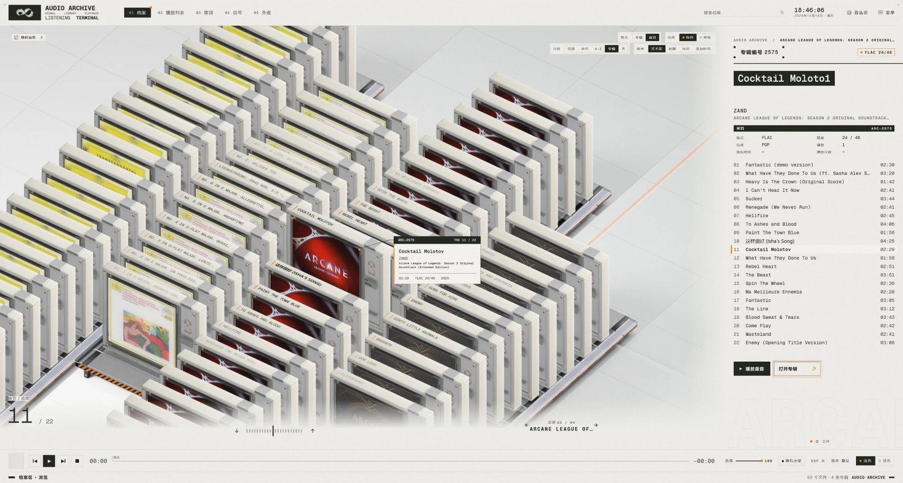
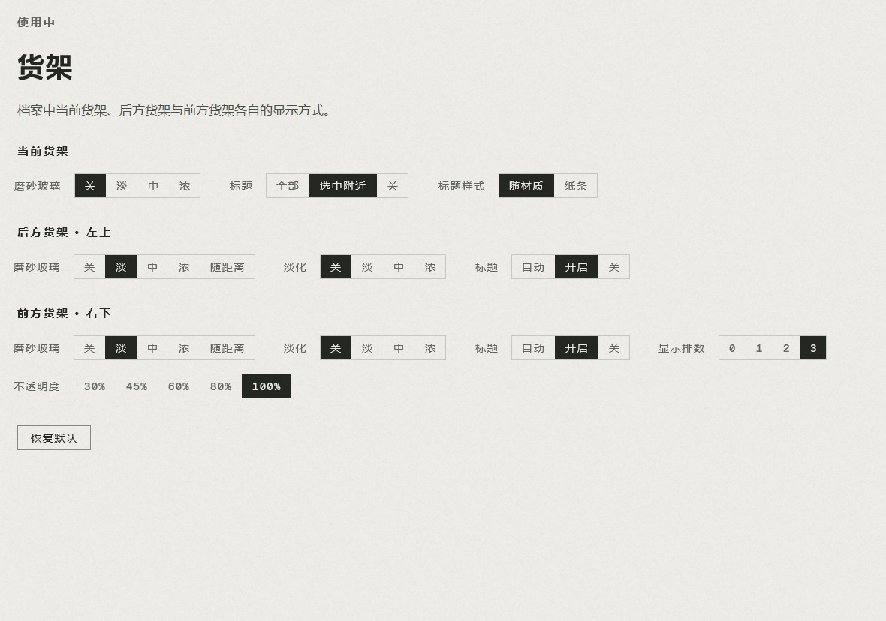
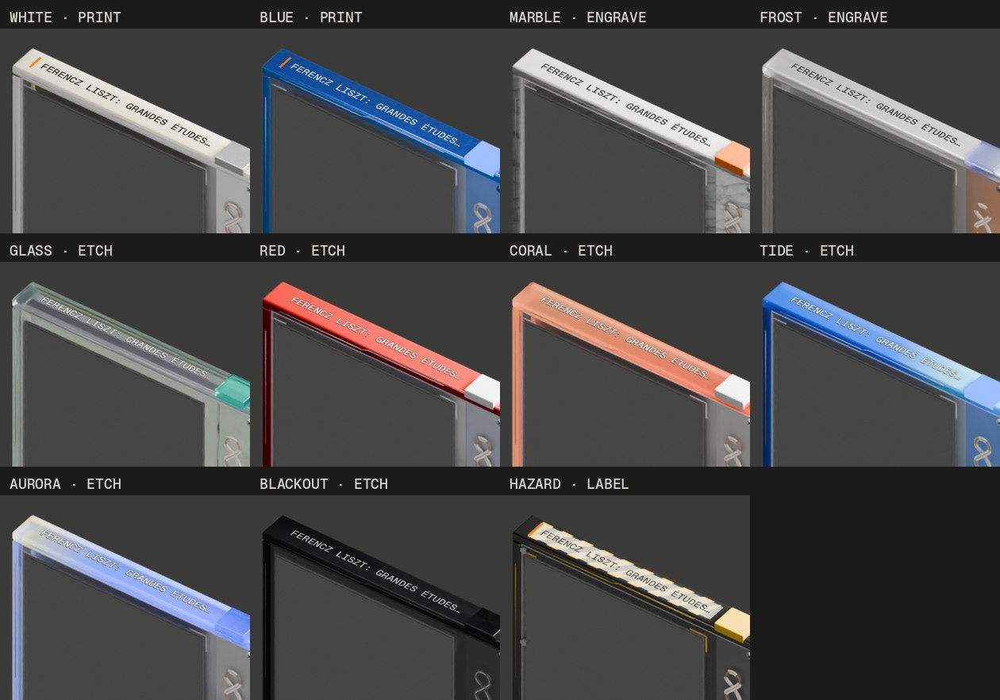
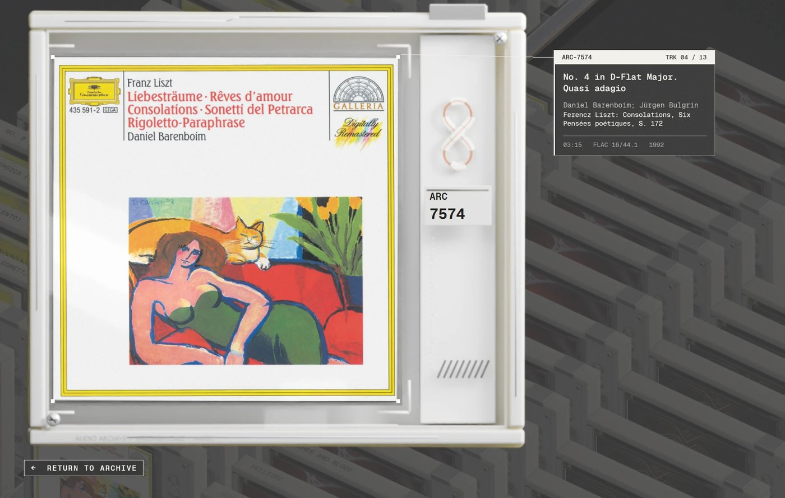
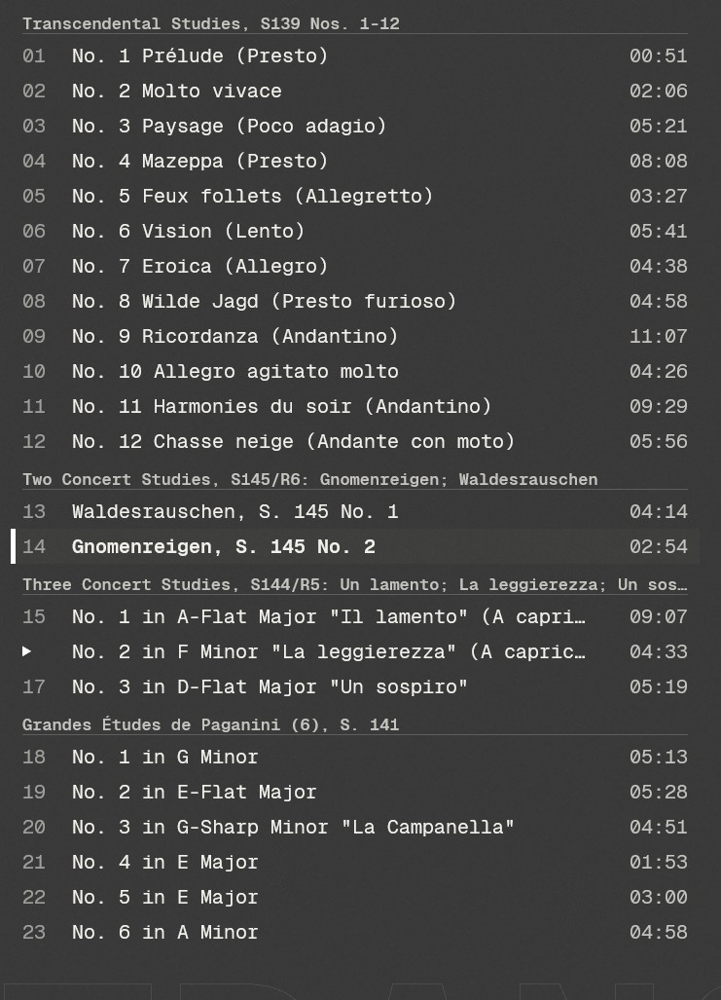

# 改动说明

这个仓库 fork 自 [ericzhang12111-cell/RhinE](https://github.com/ericzhang12111-cell/RhinE)（RhinE 1.7.2）。本页列出这个 fork 在原版之上增加或修改的功能。
原版的功能和操作说明见 [其他信息.md](其他信息.md)，那里的操作表已经按下面的改动更新。

> 注意：主题底栏的橙色 **更新** 标签会从原作者的仓库下载新版本，并替换被改过的文件，这些改动会因此丢失。请不要点击它。

*档案视图（浅色模式，按专辑分组，每首曲目单独显示）：选中的盒子右侧是信息牌，顶边标题只在选中项附近显示，右下方是前方货架。*

## 档案：货架与分组

- **排序：专辑艺术家 / 艺术家**：`排序` 多了 `专辑艺术家`。
  - `专辑艺术家`：按专辑的艺术家排，同一张专辑的曲目保持在一起，按碟号、曲号排列，原声带、合辑不会被打散。
  - `艺术家`：按每首歌自己的艺术家排，和原版一样。
  - 任何排序方式在并列时，都会按"专辑艺术家 → 年份 → 专辑 → 碟号、曲号"往下比，所以专辑内部的顺序不会乱。
  - 按专辑显示时，专辑只有专辑艺术家（没有这个标签时，取多数曲目的艺术家），所以只显示 `专辑艺术家`，不显示 `艺术家`；`分组 › 专辑` 也会隐藏，因为每排只会有一张专辑。之前的选择会保留，切回曲目模式后恢复。
- **按专辑分组**：曲目模式下，`分组` 新增 `专辑`，右键菜单里也有。每张专辑的曲目单独占货架。分组的先后顺序跟随排序方式；同名但不同艺术家的专辑会分开。
- **货架容量 10–30**：
  - 一个分组不超过 30 个，就整排放下；超过 30 个，就平均拆成几排，例如 45 拆成 23 + 22。原版每排固定 20 格，22 首的专辑会剩 2 首单独占一排。
  - 右键 › `每个分组单独占用货架`（默认开）。关闭时，小分组会合并到同一排（最多 30 个）；不足 10 个的货架，会从下一组补齐。
- **显示所有货架**：当前货架前方（右下）的货架也会显示，半透明。原版只显示当前货架和它后面的货架。

## 档案：货架外观（`05 外观` › `显示` › `货架 ›`，或右键 › `货架外观`）

当前货架、后方货架、前方货架分别设置：

| 设置 | 选项 |
|---|---|
| 磨砂玻璃 | 关闭 / 淡 / 中 / 浓（"浓"即原版效果）。后方和前方货架还可选 `随距离`：从当前货架的强度开始，越远越强，3 排之外为"浓" |
| 淡化 | 关闭 / 淡 / 中 / 浓（"中"即原版效果） |
| 标题 | 当前货架：全部 / 选中附近 / 关闭；后方、前方：自动 / 开 / 关 |
| 标题样式 | 随材质 / 纸条（见下） |
| 显示排数、不透明度 | 仅前方货架：0–3 排；30%–100% |

`恢复默认` 回到默认外观。

*货架外观编辑面板。图中是自定义的设置，不是默认值。*

切换货架时，淡化、透明度、磨砂、地板阴影、编号标签和标题都是连续变化的，不会跳变；货架移动到最后也不会再跳一下。进入档案时会预先生成着色贴图，避免第一次切换时卡顿。

切换排序、分组或显示单位（专辑 / 曲目）时，画面不再闪一下。货架保持不动，盒子从选中项开始向外依次落回架上。

## 档案：盒子上的标题和信息牌

- **标题随材质**：盒子顶边的标题不再是一张纸条，而是按外壳材质处理：
  - 塑料外壳（WHITE、BLUE）：移印。
  - MARBLE、FROST：雕刻。
  - GLASS、RED、CORAL、TIDE、AURORA、BLACKOUT：蚀刻。
  - HAZARD 的顶边是警示条纹，保留纸条。
  - 自定义外壳：按底色深浅选择墨色。

  `标题样式 › 纸条` 可以让所有外壳都改回纸条。

  
  *每种外壳默认的标题效果。由外壳渲染图合成，投影方式和主题里相同。*
- **选中附近**：标题只在选中的盒子周围显示，按到它的空间距离渐隐：同一排左右各 2 个完整显示，6 个以外不显示，隔壁货架按每排 3 格计算距离。
- **悬停**：鼠标下的盒子和它旁边的几个会显示标题，盒子抬起得更高。
- **信息牌**：取代原版选中盒子旁的 `ARC-xxxx` 小牌。
  - 内容：ARC 编号、曲号（专辑模式下为曲目数）、标题、艺术家、作品名或专辑名（专辑模式下为流派）、时长、格式、年份。
  - 位置：在盒子右上方，跟着盒子一起抬起。标题和作品名最多两行，放不下时自动缩小字号（最小 50%）。
  - 动画：切换选中项或货架时渐隐渐现；打开盒子时，信息牌从阵列移动到检视页上盒子的右侧，关闭时原路返回。
  - 打开盒子时，顶边标题会跟着盒子转动，然后淡出。

  
  *打开盒子后，信息牌停在盒子右侧，引线连到封面右上角。*

## 档案：交互

- **鼠标**：悬停或点击其他货架上的盒子，会直接切换到那一排并选中它。
- **滚轮和方向键**：滚轮向上、`↑`、`PgUp` 都沿货架往上走（即下一张），和画面方向一致。专辑索引两端的箭头改为 `↓` `↑`。
- **空格**：在档案里也是播放/暂停，和其他页面一致。
- **打开盒子**：点击选中的盒子打开，再点一次盒子就播放并放回；点击盒子外面只放回。回车同理：第一次打开，第二次播放并放回。
- **右侧曲目列表**：在曲目模式下，点击曲目会开始播放，同时在左边选中对应的盒子；列表保持原位，不会跳动。

## 古典乐等长标题

同一张专辑的曲名会自动简化，对所有专辑生效，不限于古典乐：

1. 去掉每首都相同的"xxx: "前缀（通常是作曲家）。
2. 去掉每首都相同的括号结尾，如 `(from the series …)`。
3. 相邻曲目开头相同、并在 `: `、` - ` 等分隔符处断开时，相同的部分作为作品名，后面作为乐章名。

右侧两页曲目列表会把作品名显示为标题行，每组之间空一行。盒子顶边、信息牌、档案页大标题、专辑索引和网格视图都改用简化后的标题。搜索仍然按完整标题匹配。

*原本每首都以 "Ferencz Liszt: Transcendental Studies, S139 Nos. 1-12 - …" 开头，列表里只能看到相同的前半段。*

## 其他

- **页面切换效果**（`05 外观` › `显示` › `页面切换`）：`扫描`（原版效果）/ `滑开`（没有扫描线，更快）/ `直接`（没有过渡）。
- **性能**：
  - 磨砂的盒子由两张贴图预先合成为一张，档案动画时 GPU 要画的大图大约减半，画面不变。
  - 鼠标在盒子上移动时，只重画正在抬起、落下的那几个盒子所在的区域，不再整片货架重画，而且这种小动作以约 30 帧/秒播放。切换货架、滚动、选中、打开盒子等大动作仍是 60 帧/秒。
  - 所有动画最高约 60 帧/秒。原先在开启了高精度计时器的电脑上（浏览器、游戏常会开启），动画会跑到 90–125 帧/秒。
- **底栏进度条**：播放头改用本地时钟推算位置，每秒约刷新 60 次，不再一跳一跳。
- **设置页**：打开 `货架 ›` 编辑面板时，鼠标划过外壳或配色卡片，不会再被预览盖住。

## 修复

- 按专辑分组时，检视页顶部的信息行里，专辑名和艺术家粘在一起显示。
- 文字大小调到 100% 以上时，信息牌的几行文字互相重叠。

## 改动的文件

主要改动在 `theme/js/archive.js`（档案）、`theme/js/lib/library.js`（分组、排序、短标题）和 `theme/js/style.js`（设置页）。
另外改了 `theme/js/transport.js`（进度条）、`frame.js` 和 `fx.js`（页面切换）、`grid.js`、`stage.js`、`lib/bus.js`，以及中文和日文翻译（`lib/lang/`）。
图片素材没有改动。
